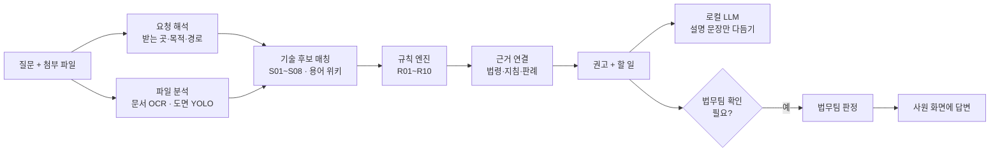

<div align="center">

# K-Ship Guard AX

**"이거 밖으로 보내도 되나요?"**
조선 설계 도면·문서를 회사 밖으로 보내기 전에 먼저 물어보는 사내 반출 사전 확인 도구


</div>

---

## 왜 만들었나

조선사의 설계 자료 중 상당수는 **국가핵심기술**(산업기술보호법, 조선 분야 8개 기술)에 해당합니다. 그런데 현장에서는 선급 검토, 해외 선주 협의, 협력사 외주처럼 자료를 밖으로 보내야 하는 일이 매일 생깁니다.

- 사원은 **어떤 자료가 고시에 해당하는지** 판단하기 어렵고,
- 법무팀은 **모든 요청을 처음부터 검토**하느라 병목이 되며,
- 판단 근거가 사람마다 달라 **기록과 일관성**이 남지 않습니다.

K-Ship Guard AX는 사원이 평소 말로 묻고 파일을 올리면 **결론 · 해야 할 일 · 근거**를 바로 답하고, 사람의 판단이 필요한 건만 법무팀에 넘깁니다.

## 주요 기능

### 사원
- **말로 묻기**: "프랑스 선급 사전검토용으로 LNG 화물창 방벽 사양서를 메일로 보내도 되나요?"처럼 묻고 파일을 첨부합니다.
- **AI 사전분석**: 받는 곳, 목적, 전송 경로, 관련 기술(S01~S08)을 알아듣고, 빠진 정보는 되물어 봅니다.
- **4단계 권고**: `진행 가능` · `조건부 진행` · `법무팀 검토 필요` · `반출 불가`. 파일마다 따로 판정합니다.
- **해야 할 일 체크리스트**와 결재선: 누구의 승인을 받아야 하는지 한눈에 보여 줍니다.
- **근거 보고서**: 판단에 쓴 법령 조항, 지침, 판례를 원문 링크와 함께 보여 줍니다.

### 법무팀
- **대시보드**: 미처리 요청, 권고 분포, 최근 요청을 봅니다.
- **검토 요청**: AI 초안(고정 기록), 첨부 원본 미리보기·다운로드, 법령·판례 검색을 보고 최종 판정과 사유를 남깁니다.
- 법무팀 답변은 사원 화면 맨 위에 바로 나타나고, **원본 열람·다운로드를 포함한 모든 행동이 감사 로그**에 남습니다.

### 파일 분석
- **문서**(PDF·DOCX): 본문과 보안등급 표기를 읽고, 스캔본은 OCR로 판독합니다.
- **도면**(P&ID 이미지): YOLO로 심볼 6개 그룹을 찾고 OCR로 태그를 읽어 도면 위에 표시합니다.

## 동작 방식



### 설계 원칙

| 원칙 | 구현 |
|---|---|
| **판단은 규칙이, 문장은 LLM이** | 권고는 규칙 엔진([`rules.yaml`](data/reference/rules.yaml))이 확정합니다. LLM은 확정된 결과를 읽기 쉬운 문장으로 바꾸는 데만 쓰고, 근거 ID와 확정 표현을 검증해 실패하면 템플릿 문장을 씁니다. |
| **근거 없는 결론 없음** | 모든 권고에 규칙별 법령 조항과 판례 카드가 연결됩니다. 의미 검색 결과는 참고로만 보여 주고 판단에는 쓰지 않습니다. |
| **자료는 밖으로 나가지 않음** | LLM, 임베딩, OCR, YOLO가 모두 로컬에서 돕니다. 테스트에서 분석 중 외부 네트워크 호출이 0건인지 검사합니다. |
| **애매하면 법무팀으로** | 정보가 부족하면 되묻고, 그래도 판단할 수 없으면 '법무팀 검토 필요'로 넘깁니다. 자동 승인은 없습니다. |
| **남는 기록** | AI 초안은 고정 저장하고, 법무팀 판정과 원본 열람은 감사 로그로 남깁니다. |

## 평가

합성 반출 요청 40건(개발용 30, 확인용 10)으로 판단 경로를 평가했습니다. 정답은 구현 코드를 보지 않고 규칙·법령·별표만 보고 작성했습니다.

| 지표 | 개발용 (30) | 확인용 (10) |
|---|---|---|
| 권고 분류 일치율 | **1.000** | 0.800 |
| 판단 근거 재현율 | **1.000** | 0.941 |
| 기술 코드 재현율 | **1.000** | **1.000** |
| 빠진 정보 질문 재현율 | **1.000** | **1.000** |

- 확인용에서 틀린 2건은 모두 **더 엄격한 쪽**으로 틀렸습니다. 위험한 자료를 '진행 가능'으로 낸 경우는 0건입니다.
- 도면 심볼 탐지(YOLO11s, 6개 그룹)는 샘플 169장으로 학습해 검증 mAP50 0.33입니다.

자세한 결과와 오류 분석은 [docs/EVAL.md](docs/EVAL.md)에 있습니다.

## 데이터

| 데이터 | 규모 | 출처 |
|---|---|---|
| 법령·고시·지침 조항 | 391개 조항 | 국가법령정보센터 (산업기술보호법·시행령, 국가핵심기술 고시, 산업기술보호지침, 대외무역법 등) |
| 판례·공정위 의결서 | 21건 (5W1H 카드) | 국가법령정보 공동활용 OPEN API |
| 기술용어 관련어 후보 | 494건 | KIPRIS Plus 시소러스 API |
| P&ID 도면 샘플 | 169장, 심볼 3,572개 | AI-Hub (저장소에는 포함하지 않음) |
| 판단 규칙 | R01~R10, P1~P4 | 고시 별표와 지침을 바탕으로 직접 작성 |

수집 방법과 선별 기준은 [docs/DATA.md](docs/DATA.md)에 있습니다.

## 기술 스택

| 영역 | 사용 기술 |
|---|---|
| 백엔드 | FastAPI, LangGraph, SQLModel + SQLite |
| 판단 | YAML 규칙 엔진 |
| 검색 | BM25 + Kiwi 형태소 분석, bge-m3 임베딩 + sqlite-vec |
| 문서·도면 | PyMuPDF, python-docx, PaddleOCR, Ultralytics YOLO11s |
| LLM | Ollama + Qwen3-4B (Q4_K_M, CPU) |
| 프론트엔드 | React 19, TypeScript, Vite 6, Tailwind CSS 4, TanStack Query |

## 시작하기

### 준비물
- Python 3.12, Node.js 20 이상
- [Ollama](https://ollama.com) (없으면 설명 문장이 템플릿으로 나갑니다)
- GPU는 필요 없습니다 (CPU 전용 구성).

### 1. 설치

```bash
python -m venv .venv
```

```bash
.venv/Scripts/python -m pip install torch torchvision --index-url https://download.pytorch.org/whl/cpu
```

```bash
.venv/Scripts/python -m pip install -r requirements.txt
```

```bash
npm --prefix frontend install
```

PyTorch를 CPU 버전으로 먼저 설치해야 다른 패키지가 GPU 버전(수 GB)을 끌어오지 않습니다.

### 2. 모델 받기

```bash
.venv/Scripts/python -I scripts/download_models.py llm-small embed yolo
```

```bash
ollama create kship-qwen3-4b -f models/ollama/qwen3-4b.Modelfile
```

도면 심볼 탐지 가중치(`models/yolo/pid_groups.pt`)는 AI-Hub P&ID 데이터로 [`scripts/train_yolo.py`](scripts/train_yolo.py)를 돌려 만듭니다. 가중치가 없으면 도면 심볼 탐지만 건너뛰고 나머지는 그대로 동작합니다.

### 3. 실행

```bash
ollama serve
```

```bash
.venv/Scripts/python -m uvicorn app.main:app --app-dir backend --port 8000
```

```bash
npm --prefix frontend run dev
```

- 화면: http://localhost:5173 · API 문서: http://127.0.0.1:8000/docs
- 오른쪽 위에서 **설계 사원 / 법무 담당** 역할을 바꿔 볼 수 있습니다.
- 백엔드를 처음 켜면 검색용 임베딩을 백그라운드에서 계산합니다(CPU 수 분, 이후 캐시). 그동안 검색은 BM25만으로 동작합니다.
- 백엔드 없이 화면만 보려면 `npm --prefix frontend run dev:mock`으로 모의 모드를 켭니다.

### 4. 테스트

```bash
.venv/Scripts/python -m pytest backend/tests -q -m "not slow"
```

규칙 엔진, 시나리오 E2E, 용어 위키, 도면 파이프라인, 외부 네트워크 호출 0건을 검사합니다.

### 데이터 다시 수집하기 (선택)

법령·판례·KIPRIS 데이터는 저장소에 들어 있어 바로 쓸 수 있습니다. 다시 수집할 때만 루트의 `.env`에 아래 키가 필요합니다.

| 키 | 용도 | 발급처 |
|---|---|---|
| `LAW_OC` | 판례·공정위 의결서 수집 (`scripts/fetch_legal.py`) | 국가법령정보 공동활용 |
| `KIPRIS_API_KEY` | 기술용어 시소러스 수집 (`scripts/kipris_thesaurus_api.py`) | KIPRIS Plus |

## 프로젝트 구조

```
K-Joseon/
├── backend/
│   ├── app/
│   │   ├── main.py            # API 엔드포인트
│   │   ├── graph.py           # LangGraph 분석 파이프라인
│   │   ├── rules_engine.py    # 규칙 엔진
│   │   ├── evidence.py        # 근거 연결
│   │   ├── search.py          # 하이브리드 검색
│   │   ├── explain.py, llm.py # 설명 문장 생성·검증
│   │   ├── wiki.py            # 용어 통일 위키
│   │   └── pipelines/         # 요청 해석, 문서·도면 분석, 보안등급 판독
│   └── tests/
├── frontend/src/
│   ├── pages/                 # 반출 검토 요청, 내 요청, 법무 대시보드·검토
│   ├── components/
│   └── api/
├── data/
│   ├── reference/             # rules.yaml, 기술 분류(S01~S08), 심볼 그룹
│   ├── legal/                 # 법령 조항, 판례 카드, 원문
│   ├── kipris/                # 시소러스 후보
│   ├── eval/                  # 평가 시나리오와 결과
│   └── demo/                  # 시연용 합성 문서
├── models/                    # Ollama Modelfile, 모델 목록 (가중치는 제외)
├── scripts/                   # 수집·학습·평가 스크립트
└── docs/
```

## 문서

| 문서 | 내용 |
|---|---|
| [docs/RULES.md](docs/RULES.md) | 판단 규칙 R01~R10과 근거 |
| [docs/DATA.md](docs/DATA.md) | 데이터 출처, 수집 방법, 현황 |
| [docs/EVAL.md](docs/EVAL.md) | 평가 지표와 결과, 오류 분석 |
| [docs/API.md](docs/API.md) | API 계약 |
| [docs/FRONTEND.md](docs/FRONTEND.md) | 화면 구조 |
| [docs/FRAMEWORK.md](docs/FRAMEWORK.md) | 기술 스택 결정 |

## 참고

- 해커톤 프로토타입입니다. 권고는 법률 자문을 대신하지 않으며, 최종 판단은 법무팀이 합니다.
- 법령·판례 원문은 국가법령정보센터의 공개 자료입니다.
- 화면 글꼴은 A2Z(SIL Open Font License)를 사용합니다. 자세한 내용은 [`frontend/src/assets/fonts/a2z/NOTICE.md`](frontend/src/assets/fonts/a2z/NOTICE.md)에 있습니다.
